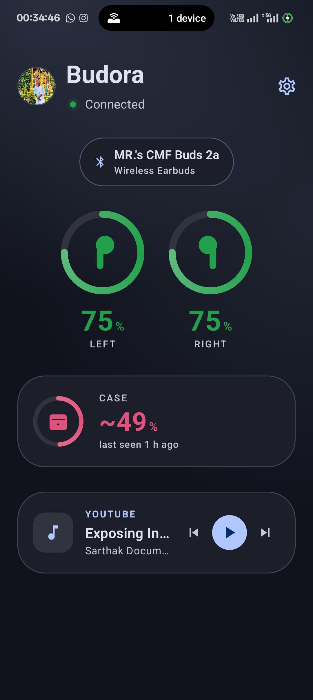
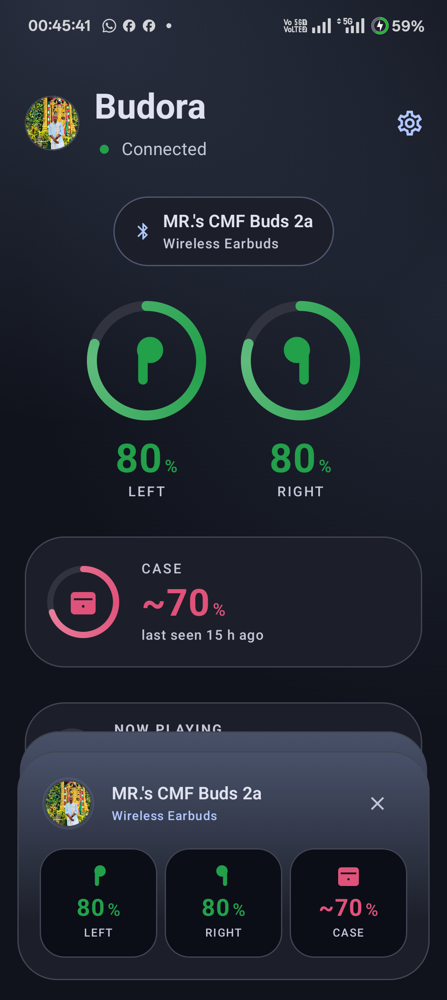
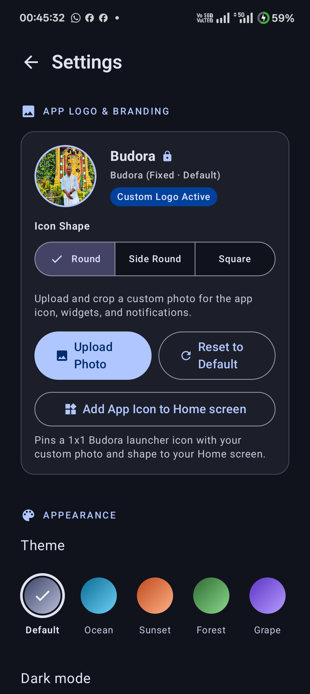
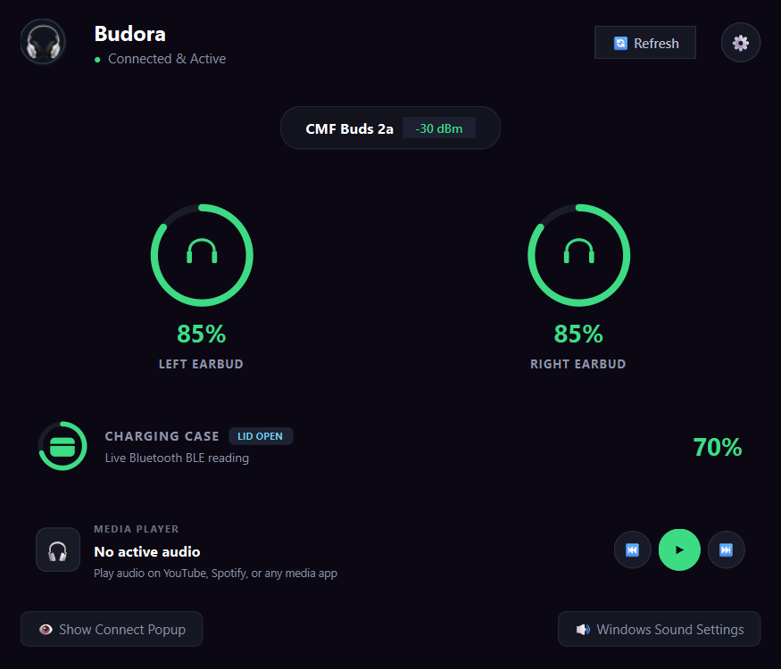
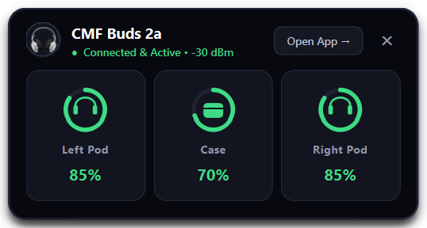
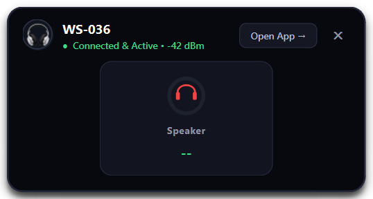

# Budora 🎧

<p align="center">
  <br>
  <strong>Universal Bluetooth Battery Telemetry & Media Companion for Windows & Android</strong><br>
  <em>Engineered with precision by <strong><a href="https://mrprem.in/">Prem Prasad Pradhan</a> — a <a href="https://www.zenemoo.in/">Zenemoo Software</a></strong></em>
</p>

<p align="center">
  <a href="https://github.com/MRPREM31/Budora"></a>
  
  
  
  <a href="docs/Budora_User_Manual.pdf"></a>
  
  
</p>

---

## 🌟 Overview

Both Windows and Android treat wireless earbuds and Bluetooth audio gear as generic audio sinks. Neither operating system provides clear, individual battery percentages for each component, leaving the **Charging Case** battery level completely invisible and hiding dual-pod telemetry behind cumbersome manufacturer-specific apps.

**Budora** solves this permanently across both desktop and mobile. 

> [!TIP]
> 📖 **Comprehensive Device Guide & Manual:** Download the [**Official Budora User Manual (PDF)**](docs/Budora_User_Manual.pdf) for the full 400+ device compatibility matrix (CMF, boAt, AirPods, Sony, JBL, Bose, Pixel Buds), protocol decoders, and step-by-step setup guides. 

Built for speed, pixel-perfect elegance, and zero background battery drain:
- On **Windows**, Budora operates as a lightweight System Tray companion featuring a Windows 11 Fluent floating connect flyout, interactive speedometer rev-up battery rings, live Global System Media Transport (GSMTC) media player controls, and smart fallback detection for classic Bluetooth speakers.
- On **Android**, Budora leverages background Bluetooth Low Energy (BLE) scanning, Google Fast Pair service hooks, Apple proximity pairing decoders, lockscreen-aware floating connect cards, and home screen widgets.

**100% Offline, Zero Tracking, Zero Ads, and Zero Telemetry Sent Across the Web.**

---

## 📸 Visual Showcase

### 📱 Real Android Mobile App (Live Telemetry & System Integration)
*Captured directly from a live Android device paired with **CMF Buds 2a**:*

<table>
  <tr>
    <td align="center" width="33%">
      <strong>🔋 Main Battery Readout</strong><br><br>
      <br>
      <em>Dual-pod battery rings, case memory (~70%), and live media playback.</em>
    </td>
    <td align="center" width="33%">
      <strong>⚡ Floating Connect Flyout</strong><br><br>
      <br>
      <em>Lockscreen-aware edge drawer that slides in on Bluetooth connection.</em>
    </td>
    <td align="center" width="33%">
      <strong>⚙️ Settings & Customization</strong><br><br>
      <br>
      <em>Themes (Ocean, Sunset, Forest), auto-dismiss timers & battery alert thresholds.</em>
    </td>
  </tr>
</table>

---

### 💻 Windows 11 Desktop Experience
*Native PySide6 desktop suite with official Budora squircle emblem & rev-up speedometer telemetry:*

<table>
  <tr>
    <td align="center" width="50%">
      <strong>🖥️ Full Desktop Dashboard with GSMTC Media Player</strong><br><br>
      
    </td>
    <td align="center" width="50%">
      <strong>⚡ Floating Connect Flyout (TWS Earbuds Mode)</strong><br><br>
      
    </td>
  </tr>
  <tr>
    <td colspan="2" align="center">
      <strong>🔊 Universal Bluetooth Speaker Box Mode (WS-036 / Soundbox)</strong><br><br>
      
      <br>
      <em>Intelligent fallback: Detects active Bluetooth speakers/boxes without battery telemetry and displays clean single-gauge audio status.</em>
    </td>
  </tr>
</table>

---

## ✨ Key Features

### 🔋 1. Live Three-Component Battery Readout
- Real-time battery levels for **Left Earbud**, **Right Earbud**, and the **Charging Case**.
- **Dynamic Color Indicators:**
  - 🟢 **Green:** Healthy battery ($> 40\%$)
  - 🟠 **Orange:** Moderate battery ($21\% - 40\%$)
  - 🔴 **Red:** Low battery ($\le 20\%$)
- **Active Charging Gauges:** Real-time charging bolt (`⚡`) badges when buds or the case are docked to power.
- **In-Case Docking Telemetry:** Intelligently dims docked pods and flags them as `(In Case)`.

### 📡 2. Dual-Engine Bluetooth & Fast Pair Decoders
- **Google Fast Pair (`0xFE2C`):** High-efficiency low-latency component frame parser (Nothing, CMF Buds, Pixel Buds, Sony, JBL).
- **Apple Proximity Protocol (`0x004C`):** Full decoding of AirPods and Beats proximity advertisement frames.
- **Universal Core Audio Fallback:** Windows Core Audio (MMDevices) integration automatically identifies connected speakers (`WS-036`, boAt, JBL) while strictly prioritizing active Fast Pair/AirPods earbuds.

### 🧠 3. Smart Case Memory
- Because charging cases power down their BLE radio when the lid closes and both buds are in your ears, Budora memorizes the last verified case battery level (marked with a `~` prefix) and automatically refreshes when pods are redocked or the case lid reopens.

### 🎛️ 4. Windows 11 Fluent Flyout & GSMTC Media Controls
- **Speedometer Rev-up Animation:** Circular vector gauges animate smoothly from 0% to the target percentage whenever the drawer appears.
- **System Tray Integration:** Runs quietly in the notification area. Left-click to open/close the dashboard, or right-click for quick actions.
- **Windows GSMTC Media Player:** Controls Windows Media players (Spotify, YouTube, Chrome, Media Player) with live track titles, artists, album artwork, and play/pause/skip buttons directly from the Budora dashboard.

### 📱 5. Android Floating Drawer & Home Screen Widgets
- **Edge Slide Flyout:** Slides smoothly into view from the bottom or top of your screen upon Bluetooth connection.
- **Lockscreen Aware:** Defers display if the phone is asleep, presenting the connect card seamlessly when you unlock (`USER_PRESENT`).
- **Launcher Widget:** 4x2 responsive home screen widget with one-tap quick flyout summon.
- **Status Bar Alerts:** Heads-up alerts when any pod drops below 20% or reaches critical low (10%).

---

## 🚀 Quick Start & Installation

### 💻 Windows Installation

#### Prerequisites
- Windows 10 (1809+) or Windows 11 (64-bit)
- Python 3.10+ (Python 3.11 recommended)
- Bluetooth adapter with BLE support

#### 1. Quick Launch (Zero Setup)
Double-click **`run.bat`** in the repository root. The launcher will automatically find Python, initialize the working directory, and launch the Budora desktop agent in the background with a system tray icon.

#### 2. Manual Installation
```powershell
# Clone the repository
git clone https://github.com/MRPREM31/Budora.git
cd Budora

# Install required Python packages
pip install PySide6 bleak winsdk pillow

# Run the Windows application
python windows/main.py
```

#### 3. Building Standalone Windows Executable (`Budora.exe`)
```powershell
pip install pyinstaller
pyinstaller --noconsole --onefile --icon=windows/icon.ico --name=Budora windows/main.py
```

---

### 📱 Android Installation

#### Prerequisites
- Android 12 (API 31) or higher
- Bluetooth and Location permissions (for BLE scanning)
- Android Studio Ladybug / Meerkat or Gradle command-line tools

#### 1. Build and Install via Gradle
```bash
# Clone the repository
git clone https://github.com/MRPREM31/Budora.git
cd Budora

# Build debug APK
./gradlew assembleDebug

# Install on your connected Android device
adb install -r app/build/outputs/apk/debug/app-debug.apk
```

---

## 🔒 Privacy & Permissions

Budora is built strictly offline. It contains no analytics SDKs, collects no telemetry, and declares **no internet access permissions**.

| Platform | Permission | Purpose |
|---|---|---|
| **Android** | `BLUETOOTH_SCAN` | Scans for Bluetooth LE Fast Pair & AirPods beacons (`neverForLocation` flag declared). |
| **Android** | `BLUETOOTH_CONNECT` | Detects when paired Bluetooth devices connect or disconnect. |
| **Android** | `POST_NOTIFICATIONS` | Displays the status row and low battery notifications. |
| **Android** | `SYSTEM_ALERT_WINDOW` | Enables the animated floating connect drawer over other apps. |
| **Windows** | `WinRT BLE & MMDevices` | Queries local Bluetooth LE advertisements and Core Audio active device endpoints. |

---

## 🛠️ Repository Structure

```
Budora/
├── app/                         # Android application (Kotlin + Jetpack Compose)
│   ├── src/main/java/com/budora/
│   │   ├── ble/                 # FastPairPayload, ProximityPayload, PodsScanner, PodsTracker
│   │   ├── data/                # Settings, CaseMemory, Appearance, Connection state
│   │   ├── service/             # Background Bluetooth LE tracking service
│   │   ├── ui/                  # Compose UI: Dashboard, Floating Drawer, Settings
│   │   └── widget/              # Android Home Screen AppWidgetProvider
│   └── build.gradle.kts
├── windows/                     # Windows desktop application (Python + PySide6)
│   ├── main.py                  # Single-instance application entry point & IPC socket
│   ├── tracker.py               # Candidate arbitration, Smart Case Memory, MMDevices fallback
│   ├── scanner.py               # Asynchronous Bleak BLE advertisement scanner
│   ├── fast_pair_payload.py     # Fast Pair 0xFE2C component frame decoder
│   ├── proximity_payload.py     # Apple proximity beacon decoder
│   ├── models.py                # BudoraState & BudoraModel dataclasses
│   ├── config.py                # Persistent settings & dynamic color band resolvers
│   ├── ui_main_window.py        # Windows 11 Fluent Dashboard & GSMTC Media Player
│   ├── ui_popup.py              # Floating connect flyout with rev-up speedometer rings
│   ├── ui_tray.py               # Windows System Tray icon & context menus
│   ├── test_budora.py           # Comprehensive unit tests
│   └── icon.ico                 # High-resolution application icon
├── docs/
│   ├── assets/screenshots/      # High-resolution showcase screenshots (Android & Windows)
│   ├── TECHNICAL.md             # In-depth Bluetooth protocol & telemetry architecture docs
│   ├── Budora_User_Manual.pdf   # Official User Manual & Device Telemetry Guide (PDF)
│   └── USER_MANUAL.tex          # Complete LaTeX source code for the User Manual
├── run.bat                      # One-click Windows application launcher
├── build.gradle.kts             # Root Gradle build script
├── settings.gradle.kts          # Gradle project configuration
└── LICENSE                      # MIT License
```

---

## 🧪 Unit Testing

Run the automated test suite for the Windows telemetry engine:
```powershell
python -m unittest windows/test_budora.py
```

Expected output:
```
....
----------------------------------------------------------------------
Ran 4 tests in 0.182s

OK
```

---

## 🤝 Contributing & Community (Pull Requests Welcome!)

**Budora is 100% open-source and built for the community!**  
Whether you want to fix a bug, optimize battery efficiency, enhance the UI, or add support for newly launched earbuds and Bluetooth speakers --- **anyone is warmly invited to contribute and improve the software for everyone!**

Every pull request, issue report, and suggestion makes Budora more reliable and capable for users worldwide.

### 💡 How You Can Help
- 🐛 **Bug Hunting \& Fixes:** Discovered a UI glitch, connectivity edge-case, or crash? Report it via [GitHub Issues](https://github.com/MRPREM31/Budora/issues) or submit a direct code fix.
- 🎧 **Device Protocols \& Telemetry:** Add support for new Google Fast Pair accessories, Apple beacon models, or proprietary Bluetooth GATT services.
- 🎨 **UI / UX Polish:** Enhance Windows 11 animations, design new Android color themes, or improve home screen widget layouts.
- 🌐 **Documentation \& Localization:** Improve guides, translate the interface into more languages, or expand the user manual.

### 🚀 Quick Start for Contributors:
1. **Fork the Repository:** Click the **Fork** button at the top-right of this repository.
2. **Clone your fork locally:**
   ```bash
   git clone https://github.com/<your-username>/Budora.git
   cd Budora
   ```
3. **Create a dedicated feature branch:**
   ```bash
   git checkout -b feature/improve-telemetry
   ```
4. **Make your improvements and test:**
   - Test Windows backend: `python -m unittest windows/test_budora.py`
   - Test Android build: `./gradlew test`
5. **Commit with a descriptive message:**
   ```bash
   git commit -m "feat: add battery telemetry support for boAt Airdopes XYZ"
   ```
6. **Push to your fork:**
   ```bash
   git push origin feature/improve-telemetry
   ```
7. **Submit a Pull Request (PR):** Navigate to [Pull Requests](https://github.com/MRPREM31/Budora/pulls) on the main repository, click **New Pull Request**, and outline what you changed. We actively review, test, and merge community contributions!

---

## 💖 Support & Donate

If **Budora** enhances your daily audio and workflow experience, consider supporting our ongoing development:

👉 **[Support Zenemoo India — Donate Here](https://www.zenemoo.in/support-zenemooindia)**

Every contribution fuels continuous development, new device telemetry integrations, and open-source innovation.

---

## 📄 License & Legal

This project is licensed under the [MIT License](LICENSE).  
Copyright (c) 2026 [**Prem Prasad Pradhan**](https://mrprem.in/) — a [**Zenemoo Software**](https://www.zenemoo.in/).

---

<p align="center">
  <a href="https://www.zenemoo.in/">
    
  </a><br>
  <strong>Budora by Zenemoo</strong><br>
  <em>Next-Generation Offline Bluetooth Telemetry for Windows & Android</em>
</p>

<p align="center">
  <a href="https://www.zenemoo.in/">🌐 Official Website</a> &bull;
  <a href="https://mrprem.in/">👨‍💻 Founder Portfolio</a> &bull;
  <a href="docs/Budora_User_Manual.pdf">📖 Official User Manual (PDF)</a> &bull;
  <a href="https://github.com/MRPREM31/Budora/pulls">🤝 Contribute & PRs</a> &bull;
  <a href="https://www.zenemoo.in/support-zenemooindia">💖 Support & Donate</a> &bull;
  <a href="https://github.com/MRPREM31/Budora/issues">🐛 Report an Issue</a>
</p>

<p align="center">
  <sub>Built with ❤️ by <a href="https://mrprem.in/">Prem Prasad Pradhan</a> under <a href="https://www.zenemoo.in/">Zenemoo Software</a>. All rights reserved.</sub>
</p>
